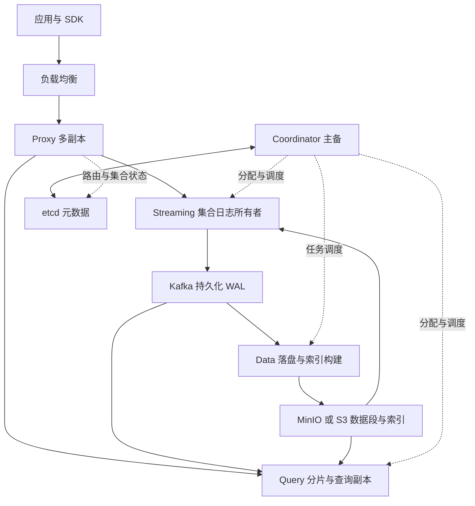

# VectorDB 存算分离分布式架构设计

状态：目标架构设计；已有实验性 P1 子集，完整架构尚未实现。日期：2026-11-17。

当前实现、阶段性差异和复现方法见 [分布式 P1 原型运行与验证](distributed-p1.md)。下文中的列式段、多分片查询、调度与生产高可用均为目标设计。

建议采用共享对象存储、持久化日志、独立查询计算的架构：etcd 管理集群元数据，Kafka 承载首版 WAL，MinIO 或 S3 保存不可变数据段和索引。VectorDB 自身实现 Proxy、Coordinator、Streaming、Query、Data 五种角色。计算节点的本地数据均可从共享存储和日志恢复。

首版优先保留现有集合内批量写入的原子性与 Strong 查询语义：每个集合使用一条有序日志，数据和查询划分为多个逻辑分片。查询、索引构建与多集合写入可以横向扩展；单集合写入仍受单日志和单写入所有者限制。多日志写入扩展是独立的后续阶段。

## 1 目标和设计边界

目标是在单地域集群内独立扩缩查询、写入处理和后台构建资源，计算节点故障后恢复已确认写入，并允许迁移查询副本时持续提供完整查询。基础设施按故障域部署，首版故障模型为单节点或单故障域失效、网络分区、进程崩溃、重复与超时请求；不包含 Byzantine 故障和整个地域永久丢失。

设计保留现有 SQLite 单机模式。分布式模式使用新的存储引擎和明确的 API 能力集，不直接让多个进程共享 SQLite，也不把 SQLite 文件上传至对象存储作为在线数据库。

首版不包含跨集合事务、跨地域同步、多写入日志的集合、在线改变分片数、完整 Milvus SDK 兼容和任意历史时间查询。当前接口中的混合检索、分组、排序分页、过滤删除逐项通过分布式语义测试后开放；未开放的功能返回明确的 unsupported 错误。

工作负载暂按固定维度向量、读多写少、单集合可以有多个查询分片设计。向量数量、维度、写入峰值、过滤选择性和 P99 延迟目标尚未确定，因此本设计不承诺容量或延迟数字。

## 2 当前实现与改造范围

代码基线为 `37107cd5764d6d74c4b4dea7ce016617794bbaab`。

| 当前实现 | 分布式模式的改造 |
| --- | --- |
| `crates/engine/src/engine.rs` 同时管理事务、Schema、实体、索引和备份 | 拆出请求校验、查询规划、段执行和存储接口；单机适配器保留 SQLite 事务 |
| `Engine` 持有一个 SQLite Connection 与排他文件锁 | 集群共享状态使用 etcd、WAL 和对象存储；本地状态只作为缓存 |
| `crates/server/src/lib.rs` 使用 `Arc<Mutex<Engine>>` 串行执行 | Proxy 使用异步路由；写入在集合内有序，查询按分片并行 |
| `index.rs` 的派生索引在内存中按需整体重建 | 增加索引持久化格式、异步构建和按段加载，避免每次写入重建全集合 |
| 查询读取 JSON 行与整个集合向量 | 列式段、向量缓冲区、标量过滤、段级执行；逐步减少全量反序列化 |
| SQLite 的批量回滚和自动 ID | WAL 批次提交、可恢复的主键状态与幂等结果 |

`schema.rs`、`filter.rs`、距离计算与索引算法可以复用，但需解除对整集合 JSON 数据和本地事务的耦合。首版磁盘向量格式保留当前 f64 数值语义；迁移到 f32 必须单独定义精度变化并验证，不能在分布式迁移时静默转换。

## 3 目标拓扑



实线表示主要数据路径，虚线表示控制路径。图中的五种角色是逻辑职责；开发环境可以合并进程，生产环境独立部署。首版 Query 同时处理历史段和 WAL 增量，Streaming 负责排序与写入校验；这是本项目的简化方案，不逐项复制 Milvus 的查询路径。

| 角色 | 责任与恢复来源 | 扩展方式 |
| --- | --- | --- |
| Proxy | 认证、校验、路由、读屏障、分发与合并；仅保留路由缓存 | 无状态多副本 |
| Coordinator | 集合生命周期、日志归属、查询分配、任务、GC；权威控制状态在 etcd | 一个活跃实例，多实例竞争租约 |
| Streaming | 单集合有序写入、主键冲突检查、去重、自动 ID、读屏障；从检查点和 WAL 恢复 | 不同集合分配到不同实例；热集合首版不能拆写 |
| Query | 历史段、增量、删除可见性、快照查询；从 manifest 和 WAL 恢复 | 分片分散到多节点，每个分片多个独立副本 |
| Data | WAL 转数据段、检查点、索引、压缩；任务输出可重复计算 | 按集合或分片分配任务，构建与查询资源隔离 |

## 4 基础设施选择

| 组件 | 首版选择 | 使用边界 |
| --- | --- | --- |
| 元数据与协调 | etcd v3 API | Schema、generation、路由、租约、manifest 指针；不存向量和逐条主键 |
| 共享存储 | S3 API，开发环境使用 MinIO | 不可变段、索引、主键检查点、幂等结果检查点、备份 |
| WAL | Kafka，采用 KRaft 部署 | 每个集合 generation 一条专用单分区日志；只支持已认证的版本组合 |
| 内部通信 | Protobuf 与 gRPC，Rust 侧评估 tonic/prost | 请求截止时间、版本、epoch、快照 token、错误类型进入协议 |
| 本地缓存 | 内存和可丢弃 SSD 缓存 | 不作为成功写入的唯一持久化位置 |
| 生产部署 | Kubernetes 与 Helm | 管理角色、服务发现、反亲和及滚动升级；不是协议依赖 |
| 运维 | Prometheus 指标，兼容 OpenTelemetry 的追踪 | 观察日志积压、检查点、读等待、缓存与恢复 |

选择 Kafka 是本项目首版的工程取舍：先验证成熟日志后端上的正确性。抽象 `DurableLog` 后可以评估 Woodpecker，但它不是当前 Rust 项目可直接替换的已验证依赖，后端必须满足 fencing、提交判定、有序回放和安全截断等契约。

Milvus 官方架构也区分元数据、对象存储、WAL 三类依赖；其 Woodpecker 方案说明 Kafka 并非架构上的必需品。[核心组件](https://milvus.io/docs/main_components.md)、[Woodpecker](https://milvus.io/docs/use-woodpecker.md)。

## 5 数据与控制状态

### 集合与分片

集合由不可复用的 `collection_id` 与 `generation` 标识；重建同名集合获得新身份，旧消息不能写入新集合。业务 partition 是集合内逻辑标签，不等同于 Kafka partition 或计算分片。

使用版本化的规范主键编码与稳定哈希：`shard = hash_v1(type_tag || pk_bytes) % shard_count`。主键在集合内唯一，因此不把业务 partition 加入哈希键。创建时固定分片数；扩容 Query 节点只迁移分片归属。首版可用 16 个逻辑分片作为实验起点，最终值由数据量和 fan-out 测试决定。

每个集合一条日志提供完整顺序。分片消费者首版读取同一日志并过滤自己的记录；同节点多个分片共享一次读取。同一查询副本不能依靠 Kafka consumer group 自动均分消息，否则某些分片会漏掉变更。此方案增加日志读取放大，必须纳入容量测试。

集合数也会影响 Kafka topic、事务 producer 和订阅数量。首版设置集合及并发订阅配额，以实测 broker 元数据开销确定上限；不能把此拓扑直接用于无限数量的小集合。

### WAL 记录

记录至少包含 `format_version`、集合身份、owner epoch、请求 ID、请求摘要、Schema 版本、操作、主键、业务 partition、实体内容和批次完整性信息。批次逻辑提交位置取其 commit 记录的 offset，形成 `CommitToken(collection_id, generation, offset)`。

一个 Kafka 事务包含整批 mutation 及 commit 摘要。消费者使用 `read_committed`，且只有验证完全部子记录数量与摘要后才原子应用整批。offset 可能有空洞，不以连续数字判断缺记录。操作结果、分配的自动 ID 与请求摘要一起写入日志。单消息大小与批次总大小分别限制；超过配额在写日志前拒绝。

### etcd 目录示意

```text
/clusters/<id>/catalog/<database>/<collection-name>
/clusters/<id>/collections/<collection-id>/spec
/clusters/<id>/collections/<collection-id>/owner
/clusters/<id>/collections/<collection-id>/manifest-head
/clusters/<id>/assignments/<collection-id>/<shard>/<replica>
/clusters/<id>/nodes/<node-id>
/clusters/<id>/tasks/<task-id>
/clusters/<id>/backups/<backup-id>
```

控制状态转换通过 etcd transaction 比较旧 revision、generation、owner epoch 和租约。watch 用于刷新缓存，不作为线性一致性证明；watch 被 compact 后执行完整读取再恢复监听。[etcd API 保证](https://etcd.io/docs/v3.6/learning/api_guarantees/)。

### 对象布局与发布

```text
<cluster>/<collection>/<generation>/segments/<segment-id>/data.parquet
<cluster>/<collection>/<generation>/segments/<segment-id>/vectors.bin
<cluster>/<collection>/<generation>/segments/<segment-id>/versions.bin
<cluster>/<collection>/<generation>/indexes/<segment-id>/<build-id>/index.bin
<cluster>/<collection>/<generation>/checkpoints/<checkpoint-id>/...
<cluster>/<collection>/<generation>/manifests/<manifest-id>.json
```

Parquet 保存标量与动态字段，向量使用有版本头、维度和校验和的连续二进制布局；稀疏和二进制向量使用各自编码。manifest 记录对象精确 key、大小、校验和、格式、Schema 版本、分片、数据覆盖范围与检查点。etcd 只保存 manifest 指针和小型控制记录，避免大事务。

Data 先上传所有不可变对象并校验，再上传 manifest，最后 CAS 发布 head。对象列表查询不用于决定数据是否提交。CAS 失败的输出是孤儿候选，经过宽限期和引用检查才能删除。需要验证所选对象存储的读后写与条件写行为。

## 6 写入与故障接管

### 正常写入

1. Proxy 校验请求并解析集合身份、Schema 版本、owner 与 epoch；集群写请求要求携带幂等键。
2. Streaming 在集合队列中串行校验批次，检查批内和已有主键冲突，计算完整 upsert 与自动 ID。主键状态由持久化检查点和 WAL 恢复，不依赖 Query 的可能滞后视图。
3. 将 mutation 和返回结果写入一个 Kafka 事务并提交；配置生产者幂等、`acks=all`。日志副本数初始设为 3，`min.insync.replicas=2`，关闭不安全 leader 选举，事务内部 topic 同样配置冗余。
4. 本地应用已提交状态后返回 commit token。成功表示记录已按日志持久化策略提交，查询端通过读屏障等待可见；不等待上传所有段或构建索引。
5. Query 和 Data 独立消费，分别推进可见状态与持久化检查点。没有涉及某分片的记录也必须推进该分片的已处理水位。

Kafka 的生产者幂等不等于业务请求幂等，也不覆盖对象存储和 etcd。[Kafka producer 配置](https://kafka.apache.org/40/configuration/producer-configs/)。

### 幂等与结果不确定

以 `(collection_id, generation, request_id)` 去重，并校验请求摘要。同一 ID 同一内容返回原结果，不再次消耗自动 ID；同一 ID 不同内容返回冲突。去重结果进入 WAL 与检查点，接管节点重建完成后才能接收新写入。

首版幂等结果保留到集合 generation 被删除，避免重试窗口外静默执行第二次；需设置容量配额。后续如采用有限保留期，协议必须携带可验证的过期时间，过期请求明确拒绝。成功前断连或提交超时返回 outcome unknown，客户端通过同一 ID 重试或结果查询恢复状态，不承诺失败即回滚。

批次校验失败不分配持久化 ID；已提交但客户端未收到响应的请求仍占用其 ID。首版自动 ID 可从串行状态机分配，保留已有事务语义；以后引入号段分配时需明确允许空洞。

提交结果未确定时，owner 暂停该集合后续冲突校验与读屏障，直到从日志确认提交或回滚；不能以猜测的本地主键状态继续处理下一批。请求截止时间只结束客户端等待，不将已提交操作撤销。

### 所有者接管与 fencing

仅有 etcd lease 不足以阻止网络分区后的旧进程继续向 Kafka 写入。协议需要双重保护：控制面的单调 owner epoch，以及日志后端对旧 producer 的隔离。

接管状态机为 `ASSIGNING → RECOVERING → ACTIVE`。Coordinator 用 CAS 增加 epoch 并写入归属；新 Streaming 使用集合固定的 `transactional.id` 初始化事务 producer，隔离旧 producer、解析旧未完成事务，再在日志提交 `ActivateEpoch`。随后从检查点回放到激活位置，重建主键、去重和 ID 状态，CAS 发布 ACTIVE 后才能接收请求。

所有数据都带 epoch。回放只允许当前已激活 epoch 的 mutation；较低 epoch 的迟到激活或数据不能改变当前状态。旧 epoch 在新激活记录之前已提交的数据必须回放保留。旧 owner 一旦被 fence 或失去租约，必须永久关闭该任务，不能自行重新初始化相同 producer；重新初始化仅由新的受控分配任务触发。

etcd 与 Kafka 不存在跨系统原子事务。每个过渡步骤必须可重入；出现较旧分配任务迟到、激活成功但 ACTIVE 发布失败或 producer 再次被隔离时，暂停写入并由 Coordinator 以更高 epoch 完成恢复。不得依据 etcd 的 ACTIVE 单独判断日志有效性。实现前须用状态机模型与故障注入证明该协议，不能把 Kafka SDK 初始化当作完整接管机制。

## 7 查询一致性与结果合并

### Strong 查询

Proxy 在请求开始后向 ACTIVE owner 申请有序读屏障。owner 将 barrier 排入同一提交队列并持久化，返回位置 `B`。所有选中 Query 分片需已完整应用至 `B`，并以同一个 `B` 执行 MVCC 查询，仅选择提交位置不大于 `B` 的最新主键版本和删除记录。

这样，屏障之前已完成的写入都可见，屏障之后的写入不会混入部分分片；慢分片必须等待或超时，禁止以不完整结果返回成功。读屏障在集合范围定义线性化点，不提供跨集合快照。首版只开放 Strong，之后再添加 token 驱动的 Session 或明确陈旧度的读模式。

Query 执行前注册有限期限的快照 pin，并固定 manifest generation；保留版本和旧对象直到相关 pin 释放。新节点若只加载了比 `B` 更新且已清理旧版本的检查点，不能接受该 token。Proxy 可以让整个查询重新申请新屏障，不能只重试一个分片到新快照。所有重试受总 deadline 约束。

### 分发与合并

先固定集合身份、路由版本、目标分片全集和快照；每个分片只选一个满足水位与资源条件的副本。响应必须携带分片、快照、generation 和完整性信息。任何分片缺失都返回可重试错误，首版不开放部分结果模式。

每个分片搜索历史段和增量，先按主键版本和 tombstone 处理可见性，再输出候选。普通无分组 FLAT top-k 可通过分片各取 k 后全局合并得到精确 top-k；ANN 是近似结果，需 oversampling 与 recall 测试。无效旧版本不能挤占最终候选而造成静默漏检；过滤或版本淘汰后需要补召回，必要时回退 FLAT。

分组搜索不能直接使用普通 top-k 合并。混合检索需先获得各子检索的全局候选与排名，再进行 RRF 或 weighted fusion；不能相加各分片局部 RRF 分数。排序分页需要全局排序与一致快照，count 需按当前可见主键计数。这些操作在独立验收前拒绝执行。

首版删除仅支持显式主键。过滤删除需固定快照、物化主键集合并定义与并发 upsert 的冲突规则，作为后续功能单独设计，不能转换成各节点异步执行同一个过滤表达式。

## 8 段持久化与日志回收

段生命周期为 `Growing → Sealed → Persisted → Indexed → Retired`。Sealed 冻结范围，Persisted 表示数据和删除记录已发布，Indexed 只是可用索引的附加状态；构建失败可使用 FLAT 查询。

Data 按统一日志边界 `C` 生成所有分片的检查点，覆盖至 C 的实体版本、删除、主键状态、去重结果、自动 ID 和 Schema。完成全部对象校验后以一个集合 manifest 发布，避免某个分片先推进检查点导致整批恢复不完整。

Query 安装检查点 C 时，将它与 offset 大于 C 的 WAL 增量合并，然后原子替换视图。旧视图与 pinned 快照继续保留；不能在段刚上传时就删除 growing 数据。索引异步发布并指向明确的段版本，过期构建结果不能替换新段。

检查点、索引和 compaction 共用 manifest head。CAS 失败后必须重读最新 manifest，重新验证输入段仍有效并合并无冲突更新；禁止用重试覆盖其他任务已发布的对象引用。

只有所有恢复必需状态都被 manifest 覆盖后，日志前缀才有资格回收。Kafka topic 首版关闭独立按时间和容量自动删除，控制器按安全水位调用受控截断，并保留恢复宽限区间。磁盘配额即将耗尽时先背压、再停止新写入，不能为了腾空间删除尚未检查点化的数据。落后于截断位置的消费者从新检查点重建。

Compaction 写新对象，通过 CAS 替换 manifest 中的一组输入段；保留活跃快照所需的历史版本和 tombstone，避免已删除数据从旧段复活。GC 同时考虑当前及在途 manifest、读 pin、备份引用和宽限期。首版宁可保留额外对象，不允许以最后访问时间判断可删除。

## 9 集合生命周期与元数据一致性

etcd 和日志的双写通过状态机完成，不尝试伪造跨系统事务。

创建过程为：CAS 保留名称和新身份为 CREATING；幂等创建日志；写入 Genesis 与初始 Schema；发布空 manifest；部署 owner 和查询分片；确认屏障可查询后转为 ACTIVE。中途失败由同一操作 ID 继续或转为显式 FAILED；CREATE 不能提前返回完成。

删除过程为：转为 DROPPING 阻止新请求；在集合日志有序提交 Drop barrier；撤销服务路由；等待在途请求和 pin 释放；将身份转为 TOMBSTONED；异步清理未被备份引用的对象和日志。名称可以重新使用，但旧 ID 不复用。

别名变更通过 etcd CAS 发布，Proxy 在每个请求开始时解析一次并固定目标 ID；已启动请求沿用旧目标。首版限制在线 Schema 变更和 truncate；后续需把版本切换写入日志并定义与在途请求的先后关系。

## 10 故障行为与恢复

| 故障 | 行为与恢复 |
| --- | --- |
| Proxy 崩溃或响应丢失 | 客户端携幂等键重试，恢复原写入结果 |
| Streaming 崩溃 | 新 epoch 隔离旧 producer，恢复检查点和日志后接管；期间该集合写入和 Strong 屏障等待或失败 |
| Query 崩溃 | 路由到已追平的同分片副本；没有完整副本时失败；替代节点从对象与 WAL 重建 |
| Data 构建崩溃 | 重试任务，未发布对象不可见；CAS 保证同一逻辑版本只发布一次 |
| Coordinator 崩溃 | 新 leader 从 etcd 恢复调度和未完成任务；既有数据路径在有效租约内继续 |
| etcd 失去多数派 | 停止 DDL、归属变化和 manifest 发布；租约失效后停止相关服务，首版不降级为旧路由读取 |
| Kafka 副本不足或不可达 | 写入和新 Strong 屏障失败；不能退回本地 WAL 后报告成功 |
| 对象存储不可用 | 已缓存数据可在有效快照与完整覆盖下查询；停止检查点发布，有限缓冲后背压写入 |
| 日志积压或磁盘紧张 | 限流和拒绝新写入，保留恢复链，暴露可操作告警 |
| 对象损坏 | 校验失败并隔离；索引可重建，原始数据必须由存储冗余或备份恢复 |

目标是在已定义的单故障模型及存储配置下，所有成功确认的写入可恢复，测试中的已确认数据丢失数必须为零。该目标不涵盖 WAL 与对象存储全部副本同时永久丢失。RTO 由故障检测、日志事务恢复、检查点下载与增量回放共同决定，需要实测。

## 11 部署与容量

开发 Compose 使用单个 etcd、单个 Kafka、单个 MinIO 及可合并的角色进程，只验证功能。容器数量增加不能替代真实跨主机故障测试。

生产参考起点为：2 个以上 Proxy、2 个 Coordinator 候选、2 个以上 Streaming、每分片 2 个 Query 副本、2 个以上 Data worker；3 成员 etcd，Kafka 至少 3 个 broker 并配置 KRaft controller quorum，对象存储使用托管 S3 或按产品要求配置跨故障域纠删码。节点数是部署起点，不是容量承诺。

查询副本、日志副本、对象存储冗余分别解决服务可用性、近期写入持久性和历史数据持久性，不能互相替代。Kubernetes 配置反亲和、资源 requests/limits、PodDisruptionBudget 和有序 drain。新 Query 先加载、追平、验证快照覆盖再接流量；旧 Query 等待请求结束才退出。

容量估算至少包含：原始稠密向量约 `N × dimension × 8` 字节，另加标量、主键、版本、索引和删除开销；查询缓存还需乘副本数。WAL 空间约为日志字节速率 × 最大恢复窗口 × 副本数，加事务和安全余量。对象存储还需预留压缩期间新旧段并存及备份空间。

监控必须覆盖：提交延迟、屏障等待、各分片消费与持久化水位、最老未持久化记录年龄、幂等结果体积、lease 与 epoch 变化、内存准入、对象错误率、缓存命中、任务排队、GC 保留对象、恢复耗时。查询和后台任务分别设置 CPU、内存、I/O 配额，队列有界。

内部 gRPC 采用服务身份与 mTLS，存储凭据通过 secret 注入且限定前缀；沿用现有外部 Bearer Token 时明确它仍是服务级权限。集群身份和 generation 必须在每条内部请求中验证，避免恢复或误配置串写其他集群。

## 12 备份与单机迁移

首版备份通过短时冻结 DDL 和写入建立边界：等待在途请求完成，为每个集合产生 barrier，完成对应全量恢复检查点，固定 manifests，再导出逻辑 catalog 和备份清单并校验所有对象，最后解除冻结。备份只在全部引用可恢复时标记 COMPLETE；复制 etcd 快照或对象桶其中之一都不构成数据库一致备份。

备份 manifest pin 阻止 GC，副本保存在独立故障域。恢复到新 cluster ID，恢复身份映射、catalog、原始数据、去重结果与 ID 状态，建立新日志起点，丢弃旧节点 lease 和路由。旧 commit token 不跨恢复集群继续使用。首版恢复工具必须有完整演练，不能只验证备份命令成功。

SQLite 迁移先停写并做一致快照。新增离线迁移器读取快照，保留数据库、集合、Schema、业务 partition、别名、索引配置、主键、动态字段和下一 ID。现有 JSONL 导出缺少其中部分元数据，不能直接当完整迁移工具。导入新集群后核对计数、主键摘要、过滤结果、FLAT 基线和 ANN recall，再切换应用地址。

旧 SQLite 快照保留用于切换前回滚。新集群开始写入后，回切需要导出增量或停止并重新迁移，不能宣称可以无损直接切回旧文件。首版不做双写和在线迁移。

## 13 Rust 模块与协议边界

以下是拟新增模块，不代表已有实现；可先在工作区内按模块组织，稳定后再拆 crate。

| 模块 | 接口与职责 |
| --- | --- |
| `protocol` | 版本化 Protobuf，CommitToken、ReadSnapshot、mutation、分片响应 |
| `catalog` | etcd CAS、租约、归属状态机、manifest 指针 |
| `log` | `DurableLog`：激活 epoch、提交批次、判定结果、读已提交记录、安全截断 |
| `storage` | `ObjectStore`：上传不可变对象、读范围、校验、引用管理 |
| `segment` | 列式段、版本与删除、快照、索引序列化和执行 |
| `coordinator` | reconciliation、调度、DDL、备份和 GC |
| `streaming` | 有序校验、去重、主键状态、提交与恢复 |
| `query` | 分片视图、增量订阅、read barrier、内存准入与查询 |
| `data` | 检查点、flush、索引、compaction |
| `proxy` | REST 到内部协议、路由、fan-out、结果合并 |

现有 `Engine::execute` 继续作为单机适配器入口；逐步提取纯校验与执行组件。不要把内部 gRPC 定义为远程调用整个 SQLite Engine。

内部 RPC 草案包括 `Mutate`、`GetWriteResult`、`ReadBarrier`、`SearchShard`、`LoadShard`、`RunTask`。所有协议携带 deadline 与 generation；可重试错误区分 NOT_OWNER、STALE_EPOCH、NOT_CAUGHT_UP、RESOURCE_EXHAUSTED、UNAVAILABLE、OUTCOME_UNKNOWN。对外能力发现接口报告部署模式、原子范围、支持的一致性和操作，避免路径相同但语义悄然改变。

## 14 分阶段交付与验收

| 阶段 | 交付内容 | 退出标准 |
| --- | --- | --- |
| P0 协议与引擎拆分 | 段格式、日志与 catalog 接口、snapshot 模型、原子性契约；保留 SQLite | 单机已有测试通过；格式往返、损坏拒绝和批次状态机模型验证通过 |
| P1 单集合存算分离 | 一个 owner、Kafka、etcd、对象段、Query 读取增量；单查询副本 | WAL 确认后任意计算进程被杀可恢复；FLAT、主键冲突、删除、幂等和读屏障正确 |
| P2 查询分布式 | 多分片、多个 Query 节点、双副本、manifest 切换、异步索引 | 相同快照与单机 FLAT 对照；迁移和故障不漏分片、不重算可见版本；ANN recall 达约定阈值 |
| P3 高可用与发布 | owner fencing、Coordinator 主备、受控日志回收、GC、备份恢复、Helm | 网络分区、迟到 owner、依赖故障、重复提交与恢复测试通过；连续负载期间无已确认数据丢失 |
| P4 单集合写扩展 | 每分片或通道多日志、全局快照与跨日志批次提交协议 | 新协议单独评审并通过事务与一致性测试；无协议前不得增加 Kafka partition 并声称保持原语义 |

P1 是可验证原型，P3 才是本设计的首个可运营分布式版本。实现顺序必须先建立正确性基础，随后优化性能。

P4 需要在两种语义中作显式选择：保留集合级批量原子性并引入事务决策日志、参与者准备与恢复协议；或提供新的分片级原子 API，让应用处理跨分片部分成功。Kafka 跨分区事务本身不解决查询节点在同一快照上的可见性。吞吐优化不能静默改变现有 API。

验收包含以下独立证据：

- 并发历史检查：读写屏障、insert 唯一性、upsert、批次全有或全无和故障接管满足集合内契约。
- 在 Kafka 提交前后、对象上传后、manifest 发布前后、截断前后逐点崩溃；重复回放结果相同。
- 隔离旧 owner 后触发新 owner，随后恢复旧进程；旧 producer 和迟到 epoch 不能污染有效数据。
- 并发更新删除、压缩、查询 pin、节点迁移及备份，验证不复活、不漏读、不提前 GC。
- 清空全部计算节点缓存，仅保留基础设施后重建；从独立备份恢复到新集群并核对数据摘要。
- 固定数据与查询分布，测 1、2、4 个 Query 节点的吞吐、P50/P95/P99、recall、恢复时间和成本；记录 WAL 消费放大与单集合写入瓶颈。

## 15 设计依据与待验证决策

Milvus 本地参考提交为 `61de3a82cce970235f9ffb0c90b38749d0c3b196`。参考点包括日志作为变更来源、channel 分配与 term、可确认水位、事务回放和段恢复；首版不照搬其完整通道与时间戳体系。

- [本项目当前架构](architecture.md)、[能力对照](compatibility.md)、[运维约束](operations.md)。
- [Milvus Streaming 系统](../../reference-code/milvus/docs/agent_guides/streaming-system/streaming-system.md)。
- [Milvus channel 管理](../../reference-code/milvus/docs/agent_guides/streaming-system/coordination/channel_management.md)。
- [Milvus TimeTick 与事务](../../reference-code/milvus/docs/agent_guides/streaming-system/wal/timetick_and_txn.md)。
- [Milvus 官方架构](https://milvus.io/docs/architecture_overview.md)，2026-11-17 查阅；在线文档会随版本变化，以明确的源码提交作为本地参考基线。

实施前 P0 必须关闭的技术决策：Kafka 与 Rust 客户端的版本兼容及 fencing 行为、对象存储一致性验证、索引持久化格式、快照 pin 与版本回收协议。容量规划还需补充目标数据量、维度、QPS、写入峰值、RTO 和成本预算。这些参数影响部署规格，不改变共享存储与独立计算的总体方向。
