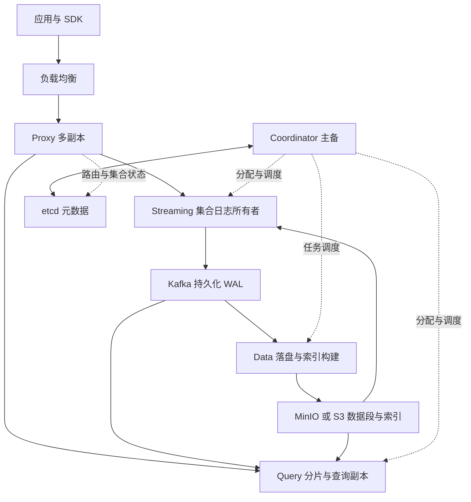

# VectorDB Rust 核心架构与实施计划

日期：2026-11-17。状态：M0—M3 已实现，其余里程碑待实施与验收。初始方案代码基线：`179e2d314b90077d81e4cd4b391dc1110c337d01`。

目标是使用 Rust 实现可持续运行、支持存算分离和分片扩展的向量数据库，提供自己的 API。验收依据是数据正确性、检索效果、扩展能力与故障恢复，不要求兼容 Milvus 的接口、SDK、错误码或磁盘格式。

本文是核心功能范围、架构协议、实施顺序和验收要求的唯一权威计划。当前代码能力见 [功能对照](compatibility.md)，当前集群运行方法见 [集群运行与验证](distributed-p1.md)。P1 是早期原型的历史名称；M0—M3 的实现和验收依据记录在第 12 节。

核心 V1 以 M0—M6 全部验收通过为完成条件。M7 单集合写入横向扩展以及文本检索等后续工作单独验收，不包含在 V1 完成声明中。

## 1 核心 V1 的范围与完成标准

V1 同时具备以下能力，才能标记为完成：

1. 集合、固定 Schema、逻辑分区、手工主键与自动 ID，支持 insert、完整行 upsert、主键删除、get、过滤查询和向量搜索。数据库命名空间、多集合与集合别名可由集群统一管理。
2. 稠密向量支持 FLAT、HNSW、IVF_FLAT，以及 L2、IP、COSINE；保留现有稀疏与二进制向量的精确搜索能力。支持标量过滤、批量搜索和多向量结果融合。
3. 数据按段持久化，索引可持久化和重新加载；封存段不可变，增量写入不触发整个集合重建。数据与索引存储在对象存储中，计算节点本地数据可丢弃重建。
4. 同一集合的数据分布在多个分片，查询跨节点执行并正确合并。每个分片可部署多个查询副本，单个节点不必保存整个集合。
5. 集合内批量写入具有原子性；成功确认的写入在约定故障模型内可恢复；Strong 查询在一个集合快照上执行，更新与删除不会因回放、迁移或压缩而丢失或复活。
6. 节点故障能自动发现、隔离和恢复；支持副本迁移、节点扩缩容和受控滚动升级。
7. 检查点、日志截断、版本回收、对象清理和压缩形成完整闭环，存储需求由活跃数据、保留窗口和备份决定，不随全部历史操作无限增长。
8. 提供一致备份恢复、基本身份权限、指标与告警、部署工具，以及可复现的正确性、性能和故障验证。

这里的“Rust 实现”指数据库核心逻辑用 Rust 编写；允许使用经过审查的库和独立基础设施。现有 SQLite、librdkafka 等原生依赖不是本次需要全部重写的对象。

### 功能范围与延后项

| 范围 | 核心 V1 | 后续扩展 |
| --- | --- | --- |
| 数据模型 | 命名空间、集合、集合别名、固定 Schema、动态 JSON 字段、nullable、默认值、逻辑分区、Int64/字符串主键 | 在线 Schema 演进、复杂嵌套类型、TTL |
| 写入 | 原子批量 insert、完整行 upsert、显式主键删除、幂等重试 | 部分字段更新、过滤删除、跨集合事务 |
| 检索 | 稠密 ANN、稀疏/二进制精确搜索、标量过滤、范围搜索、get/query/count、批量搜索、RRF/weighted 融合 | BM25、稀疏倒排、复杂聚合、分组搜索 |
| 索引 | FLAT/HNSW/IVF_FLAT、基础标量索引、索引持久化、后台构建 | PQ/SQ 量化、磁盘 ANN、GPU |
| 一致性 | 集合级 Strong 快照、读己之写、原子批次 | Session/Bounded/Eventual 可选模式、用户时间旅行 |
| 分布式 | 固定逻辑分片数、查询副本、自动迁移、单集合有序写入、多集合并行 | 单集合多日志写入、在线改变分片数、跨地域同步 |
| 接口 | 自有 HTTP API、Rust 接口、Python 基础客户端；内部协议版本化 | 其他语言客户端、按需求补充协议 |
| 运维 | 读写/管理权限、TLS、基础配额、指标、备份恢复、Helm | 复杂组织 RBAC、完整审计平台、跨地域灾备自动化 |

RAG 文本检索作为紧接 V1 的独立扩展：tokenizer、稀疏倒排、BM25 与稠密/文本融合。GPU、全部 Milvus 索引类型和 Milvus 客户端适配不作为核心 V1 的完成条件。

现有单机支持但 V1 分布式尚不支持的操作继续通过能力清单区分，不静默改变单机语义，也不把占位成功响应当作实现。

## 2 当前基线与统一决策

当前单机入口仍使用 SQLite，保留基础 CRUD、过滤与向量检索。集群已切换到原生主键状态表、批次暂存、Parquet/向量段和状态检查点，移除了写入/回放的整库复制。集群原生引擎已支持持久化 HNSW/IVF_FLAT、后台构建、过滤索引和并发读视图。M3 已增加多集合目录、别名、可恢复的集合/分区生命周期及接管。查询仍为完整集合副本；分片查询、自动调度与生产高可用继续按 M4—M6 实现。

| 决策 | 统一规定 |
| --- | --- |
| 向量精度 | 新集合默认 Float32；迁移已有 f64 数据时提供显式 Float64 选项，不静默降精度 |
| 幂等结果保留 | 有界且公开的保留窗口；过期请求明确拒绝；窗口与结果进入检查点 |
| 单机演进 | 旧 SQLite 保留为迁移源与测试参照；新单机和集群共享段与查询执行器 |
| 内部通信 | 使用自有版本化 Protobuf/gRPC 和 mTLS；不复用 Milvus 协议 |
| 集合别名 | 纳入 V1，在 M3 实现原子别名变更，并纳入备份与迁移 |
| 写入扩展 | V1 每集合一条有序日志；多集合可并行；单集合多日志在 M7 实现 |

故障模型为单地域内单节点或约定单故障域失效、网络分区、进程崩溃、重复和超时请求，不包含 Byzantine 故障和整个地域永久丢失。工作负载先按固定维度、读多写少建模，绝对性能与恢复门槛在 M0 固定硬件和初始基准后确定。

单机和分布式模式共享 Schema、查询、段和索引执行器。新单机使用本地 catalog、日志和文件存储适配器，分布式使用 etcd、Kafka 与 S3。新执行器通过验收后成为默认数据路径；不共享运行中的 SQLite 文件，也不将 SQLite 文件当作在线对象存储格式。

`schema.rs`、`filter.rs`、距离计算与索引算法可复用，但必须解除对整集合 JSON 数据和本地 SQLite 事务的耦合。

## 3 拓扑与基础设施



实线表示主要数据路径，虚线表示控制路径。图中的五种角色是逻辑职责；开发环境可以合并进程，生产环境独立部署。首版 Query 同时处理历史段和 WAL 增量，Streaming 负责排序与写入校验；这是本项目的简化方案，不逐项复制 Milvus 的查询路径。

| 角色 | 责任与恢复来源 | 扩展方式 |
| --- | --- | --- |
| Proxy | 认证、校验、路由、读屏障、分发与合并；仅保留路由缓存 | 无状态多副本 |
| Coordinator | 集合生命周期、日志归属、查询分配、任务、GC；权威控制状态在 etcd | 一个活跃实例，多实例竞争租约 |
| Streaming | 单集合有序写入、主键冲突检查、去重、自动 ID、读屏障；从检查点和 WAL 恢复 | 不同集合分配到不同实例；热集合首版不能拆写 |
| Query | 历史段、增量、删除可见性、快照查询；从 manifest 和 WAL 恢复 | 分片分散到多节点，每个分片多个独立副本 |
| Data | WAL 转数据段、检查点、索引、压缩；任务输出可重复计算 | 按集合或分片分配任务，构建与查询资源隔离 |

### 基础设施选择

| 组件 | 首版选择 | 使用边界 |
| --- | --- | --- |
| 元数据与协调 | etcd v3 API | Schema、generation、路由、租约、manifest 指针；不存向量和逐条主键 |
| 共享存储 | S3 API；开发环境沿用 P1 的 S3 兼容测试服务 | 不可变段、索引、主键检查点、幂等结果检查点、备份 |
| WAL | Kafka，采用 KRaft 部署 | 每个集合 generation 一条专用单分区日志；只支持已认证的版本组合 |
| 内部通信 | 自有 Protobuf/gRPC 与 mTLS，Rust 侧评估 tonic/prost | 请求截止时间、版本、epoch、快照 token、错误类型进入协议 |
| 本地缓存 | 内存和可丢弃 SSD 缓存 | 不作为成功写入的唯一持久化位置 |
| 生产部署 | Kubernetes 与 Helm | 管理角色、服务发现、反亲和及滚动升级；不是协议依赖 |
| 运维 | Prometheus 指标，兼容 OpenTelemetry 的追踪 | 观察日志积压、检查点、读等待、缓存与恢复 |

选择 Kafka 是本项目首版的工程取舍：先验证成熟日志后端上的正确性。抽象 `DurableLog` 后可以评估 Woodpecker，但它不是当前 Rust 项目可直接替换的已验证依赖，后端必须满足 fencing、提交判定、有序回放和安全截断等契约。

Milvus 官方架构也区分元数据、对象存储、WAL 三类依赖；其 Woodpecker 方案说明 Kafka 并非架构上的必需品。[核心组件](https://milvus.io/docs/main_components.md)、[Woodpecker](https://milvus.io/docs/use-woodpecker.md)。

V1 保持每集合一条有序日志。读取、索引构建和多集合写入可以独立扩展；增加 Query 节点不意味着单集合写吞吐线性增长。

## 4 数据布局与控制状态

### 集合与分片

集合由不可复用的 `collection_id` 与 `generation` 标识；重建同名集合获得新身份，旧消息不能写入新集合。业务 partition 是集合内逻辑标签，不等同于 Kafka partition 或计算分片。

使用版本化的规范主键编码与稳定哈希：`shard = hash_v1(type_tag || pk_bytes) % shard_count`。主键在集合内唯一，因此不把业务 partition 加入哈希键。创建时固定分片数；扩容 Query 节点只迁移分片归属。首版可用 16 个逻辑分片作为实验起点，最终值由数据量和 fan-out 测试决定。

每个集合一条日志提供完整顺序。分片消费者首版读取同一日志并过滤自己的记录；同节点多个分片共享一次读取。同一查询副本不能依靠 Kafka consumer group 自动均分消息，否则某些分片会漏掉变更。此方案增加日志读取放大，必须纳入容量测试。

集合数也会影响 Kafka topic、事务 producer 和订阅数量。首版设置集合及并发订阅配额，以实测 broker 元数据开销确定上限；不能把此拓扑直接用于无限数量的小集合。

### WAL 记录

记录至少包含 `format_version`、集合身份、owner epoch、请求 ID、请求摘要、Schema 版本、操作、主键、业务 partition、实体内容和批次完整性信息。批次逻辑提交位置取其 commit 记录的 offset，形成 `CommitToken(collection_id, generation, offset)`。

一个 Kafka 事务包含整批 mutation 及 commit 摘要。消费者使用 `read_committed`，且只有验证完全部子记录数量与摘要后才原子应用整批。offset 可能有空洞，不以连续数字判断缺记录。操作结果、分配的自动 ID 与请求摘要一起写入日志。单消息大小与批次总大小分别限制；超过配额在写日志前拒绝。

### etcd 目录示意

```text
/clusters/<id>/catalog/<database>/<collection-name>
/clusters/<id>/collections/<collection-id>/spec
/clusters/<id>/collections/<collection-id>/owner
/clusters/<id>/collections/<collection-id>/manifest-head
/clusters/<id>/assignments/<collection-id>/<shard>/<replica>
/clusters/<id>/nodes/<node-id>
/clusters/<id>/tasks/<task-id>
/clusters/<id>/backups/<backup-id>
```

控制状态转换通过 etcd transaction 比较旧 revision、generation、owner epoch 和租约。watch 用于刷新缓存，不作为线性一致性证明；watch 被 compact 后执行完整读取再恢复监听。[etcd API 保证](https://etcd.io/docs/v3.6/learning/api_guarantees/)。

### 对象布局与发布

```text
<cluster>/<collection>/<generation>/segments/<segment-id>/data.parquet
<cluster>/<collection>/<generation>/segments/<segment-id>/vectors.bin
<cluster>/<collection>/<generation>/segments/<segment-id>/versions.bin
<cluster>/<collection>/<generation>/indexes/<segment-id>/<build-id>/index.bin
<cluster>/<collection>/<generation>/checkpoints/<checkpoint-id>/...
<cluster>/<collection>/<generation>/manifests/<manifest-id>.json
```

Parquet 保存标量与动态字段，向量使用有版本头、维度和校验和的连续二进制布局；稀疏和二进制向量使用各自编码。manifest 记录对象精确 key、大小、校验和、格式、Schema 版本、分片、数据覆盖范围与检查点。etcd 只保存 manifest 指针和小型控制记录，避免大事务。

Data 先上传所有不可变对象并校验，再上传 manifest，最后 CAS 发布 head。对象列表查询不用于决定数据是否提交。CAS 失败的输出是孤儿候选，经过宽限期和引用检查才能删除。需要验证所选对象存储的读后写与条件写行为。

## 5 写入与所有者接管

### 正常写入

1. Proxy 校验请求并解析集合身份、Schema 版本、owner 与 epoch；集群写请求要求携带幂等键。
2. Streaming 在集合队列中串行校验批次，使用批次暂存区与主键索引检查冲突，计算完整 upsert 与自动 ID，不复制整个数据库。主键状态本地持久化为可重建缓存，通过共享检查点和 WAL 恢复，不依赖 Query 的可能滞后视图。
3. 将 mutation 和返回结果写入一个 Kafka 事务并提交；配置生产者幂等、`acks=all`。日志副本数初始设为 3，`min.insync.replicas=2`，关闭不安全 leader 选举，事务内部 topic 同样配置冗余。
4. 本地应用已提交状态后返回 commit token。成功表示记录已按日志持久化策略提交，查询端通过读屏障等待可见；不等待上传所有段或构建索引。
5. Query 和 Data 独立消费，分别推进可见状态与持久化检查点。没有涉及某分片的记录也必须推进该分片的已处理水位。

Kafka 的生产者幂等不等于业务请求幂等，也不覆盖对象存储和 etcd。[Kafka producer 配置](https://kafka.apache.org/40/configuration/producer-configs/)。

### 幂等与结果不确定

以 `(collection_id, generation, request_id)` 去重，并校验请求摘要。同一 ID 同一内容返回原结果，不再次消耗自动 ID；同一 ID 不同内容返回冲突。去重结果进入 WAL 与检查点，接管节点重建完成后才能接收新写入。

V1 幂等结果采用有界且公开的保留窗口，请求携带服务端可验证的有效期，过期重试明确拒绝。窗口、水位和去重结果进入检查点，不能删除结果后将旧键视为新请求。旧 P1 的永久历史去重策略通过版本化迁移转换。M0 固定为 24 小时窗口，键格式为 `v2-<issuedUnixMs>-<nonce>`：有效期是键身份的一部分，服务端验证时间戳、最多 60 秒未来时钟偏差和过期边界；修改时间戳等同新请求，不是续期。过期返回冲突，绝不静默重执行。成功前断连或提交超时返回 outcome unknown，客户端通过同一 ID 重试或结果查询恢复状态，不承诺失败即回滚。

批次校验失败不分配持久化 ID；已提交但客户端未收到响应的请求仍占用其 ID。首版自动 ID 可从串行状态机分配，保留已有事务语义；以后引入号段分配时需明确允许空洞。

提交结果未确定时，owner 暂停该集合后续冲突校验与读屏障，直到从日志确认提交或回滚；不能以猜测的本地主键状态继续处理下一批。请求截止时间只结束客户端等待，不将已提交操作撤销。

### 所有者接管与 fencing

仅有 etcd lease 不足以阻止网络分区后的旧进程继续向 Kafka 写入。协议需要双重保护：控制面的单调 owner epoch，以及日志后端对旧 producer 的隔离。

接管状态机为 `ASSIGNING → RECOVERING → ACTIVE`。Coordinator 用 CAS 增加 epoch 并写入归属；新 Streaming 使用集合固定的 `transactional.id` 初始化事务 producer，隔离旧 producer、解析旧未完成事务，再在日志提交 `ActivateEpoch`。随后从检查点回放到激活位置，重建主键、去重和 ID 状态，CAS 发布 ACTIVE 后才能接收请求。

所有数据都带 epoch。回放只允许当前已激活 epoch 的 mutation；较低 epoch 的迟到激活或数据不能改变当前状态。旧 epoch 在新激活记录之前已提交的数据必须回放保留。旧 owner 一旦被 fence 或失去租约，必须永久关闭该任务，不能自行重新初始化相同 producer；重新初始化仅由新的受控分配任务触发。

etcd 与 Kafka 不存在跨系统原子事务。每个过渡步骤必须可重入；出现较旧分配任务迟到、激活成功但 ACTIVE 发布失败或 producer 再次被隔离时，暂停写入并由 Coordinator 以更高 epoch 完成恢复。不得依据 etcd 的 ACTIVE 单独判断日志有效性。实现前须用状态机模型与故障注入证明该协议，不能把 Kafka SDK 初始化当作完整接管机制。

## 6 查询快照与结果合并

### Strong 查询

Proxy 在请求开始后向 ACTIVE owner 申请有序读屏障。owner 将 barrier 排入同一提交队列并持久化，返回位置 `B`。所有选中 Query 分片需已完整应用至 `B`，并以同一个 `B` 执行 MVCC 查询，仅选择提交位置不大于 `B` 的最新主键版本和删除记录。

这样，屏障之前已完成的写入都可见，屏障之后的写入不会混入部分分片；慢分片必须等待或超时，禁止以不完整结果返回成功。读屏障在集合范围定义线性化点，不提供跨集合快照。首版只开放 Strong，之后再添加 token 驱动的 Session 或明确陈旧度的读模式。

Query 执行前注册有限期限的快照 pin，并固定 manifest generation；保留版本和旧对象直到相关 pin 释放。新节点若只加载了比 `B` 更新且已清理旧版本的检查点，不能接受该 token。Proxy 可以让整个查询重新申请新屏障，不能只重试一个分片到新快照。所有重试受总 deadline 约束。

### 分发与合并

先固定集合身份、路由版本、目标分片全集和快照；每个分片只选一个满足水位与资源条件的副本。响应必须携带分片、快照、generation 和完整性信息。任何分片缺失都返回可重试错误，首版不开放部分结果模式。

每个分片搜索历史段和增量，先按主键版本和 tombstone 处理可见性，再输出候选。普通无分组 FLAT top-k 可通过分片各取 k 后全局合并得到精确 top-k；ANN 是近似结果，需 oversampling 与 recall 测试。无效旧版本不能挤占最终候选而造成静默漏检；过滤或版本淘汰后需要补召回，必要时回退 FLAT。

分组搜索不能直接使用普通 top-k 合并。混合检索需先获得各子检索的全局候选与排名，再进行 RRF 或 weighted fusion；不能相加各分片局部 RRF 分数。排序分页需要全局排序与一致快照，count 需按当前可见主键计数。混合检索、全局排序分页和 count 在 M4 完成独立验收后开放；分组搜索属于 V1 后续扩展。

首版删除仅支持显式主键。过滤删除需固定快照、物化主键集合并定义与并发 upsert 的冲突规则，作为后续功能单独设计，不能转换成各节点异步执行同一个过滤表达式。

## 7 段持久化与安全回收

段生命周期为 `Growing → Sealed → Persisted → Indexed → Retired`。Sealed 冻结范围，Persisted 表示数据和删除记录已发布，Indexed 只是可用索引的附加状态；构建失败可使用 FLAT 查询。

Data 按统一日志边界 `C` 生成所有分片的检查点，覆盖至 C 的实体版本、删除、主键状态、去重结果、自动 ID 和 Schema。完成全部对象校验后以一个集合 manifest 发布，避免某个分片先推进检查点导致整批恢复不完整。

Query 安装检查点 C 时，将它与 offset 大于 C 的 WAL 增量合并，然后原子替换视图。旧视图与 pinned 快照继续保留；不能在段刚上传时就删除 growing 数据。索引异步发布并指向明确的段版本，过期构建结果不能替换新段。

检查点、索引和 compaction 共用 manifest head。CAS 失败后必须重读最新 manifest，重新验证输入段仍有效并合并无冲突更新；禁止用重试覆盖其他任务已发布的对象引用。

只有所有恢复必需状态都被 manifest 覆盖后，日志前缀才有资格回收。Kafka topic 首版关闭独立按时间和容量自动删除，控制器按安全水位调用受控截断，并保留恢复宽限区间。磁盘配额即将耗尽时先背压、再停止新写入，不能为了腾空间删除尚未检查点化的数据。落后于截断位置的消费者从新检查点重建。

Compaction 写新对象，通过 CAS 替换 manifest 中的一组输入段；保留活跃快照所需的历史版本和 tombstone，避免已删除数据从旧段复活。GC 同时考虑当前及在途 manifest、读 pin、备份引用和宽限期。首版宁可保留额外对象，不允许以最后访问时间判断可删除。

### 数值格式与索引执行

新增集合默认稠密向量类型采用 Float32，迁移已有 f64 数据时保留显式 Float64 选项，禁止静默降精度。不同 dtype 的距离误差、索引精度和容量分别测试。已有稀疏和二进制编码也必须具有格式版本。

Growing 段先使用有界 FLAT 执行，达到阈值后封存并构建 ANN；Sealed 段的索引只针对该段构建和替换。是否引入在线增量 HNSW 由基准决定，不作为避免全库重建的唯一手段。

## 8 集合与别名生命周期

etcd 和日志的双写通过状态机完成，不尝试伪造跨系统事务。

创建过程为：CAS 保留名称和新身份为 CREATING；幂等创建日志；写入 Genesis 与初始 Schema；发布空 manifest；部署 owner 和查询分片；确认屏障可查询后转为 ACTIVE。中途失败由同一操作 ID 继续或转为显式 FAILED；CREATE 不能提前返回完成。

删除过程为：转为 DROPPING 阻止新请求；在集合日志有序提交 Drop barrier；撤销服务路由；等待在途请求和 pin 释放；将身份转为 TOMBSTONED；异步清理未被备份引用的对象和日志。名称可以重新使用，但旧 ID 不复用。

别名变更通过 etcd CAS 发布，Proxy 在每个请求开始时解析一次并固定目标 ID；已启动请求沿用旧目标。首版限制在线 Schema 变更和 truncate；后续需把版本切换写入日志并定义与在途请求的先后关系。

## 9 故障行为与恢复边界

| 故障 | 行为与恢复 |
| --- | --- |
| Proxy 崩溃或响应丢失 | 客户端携幂等键重试，恢复原写入结果 |
| Streaming 崩溃 | 新 epoch 隔离旧 producer，恢复检查点和日志后接管；期间该集合写入和 Strong 屏障等待或失败 |
| Query 崩溃 | 路由到已追平的同分片副本；没有完整副本时失败；替代节点从对象与 WAL 重建 |
| Data 构建崩溃 | 重试任务，未发布对象不可见；CAS 保证同一逻辑版本只发布一次 |
| Coordinator 崩溃 | 新 leader 从 etcd 恢复调度和未完成任务；既有数据路径在有效租约内继续 |
| etcd 失去多数派 | 停止 DDL、归属变化和 manifest 发布；租约失效后停止相关服务，首版不降级为旧路由读取 |
| Kafka 副本不足或不可达 | 写入和新 Strong 屏障失败；不能退回本地 WAL 后报告成功 |
| 对象存储不可用 | 已缓存数据可在有效快照与完整覆盖下查询；停止检查点发布，有限缓冲后背压写入 |
| 日志积压或磁盘紧张 | 限流和拒绝新写入，保留恢复链，暴露可操作告警 |
| 对象损坏 | 校验失败并隔离；索引可重建，原始数据必须由存储冗余或备份恢复 |

目标是在已定义的单故障模型及存储配置下，所有成功确认的写入可恢复，测试中的已确认数据丢失数必须为零。该目标不涵盖 WAL 与对象存储全部副本同时永久丢失。RTO 由故障检测、日志事务恢复、检查点下载与增量回放共同决定，需要实测。

## 10 部署与容量

开发 Compose 使用单个 etcd、单个 Kafka、单个 S3 兼容存储及可合并的角色进程，只验证功能。容器数量增加不能替代真实跨主机故障测试。

生产参考起点为：2 个以上 Proxy、2 个 Coordinator 候选、2 个以上 Streaming、每分片 2 个 Query 副本、2 个以上 Data worker；3 成员 etcd，Kafka 至少 3 个 broker 并配置 KRaft controller quorum，对象存储使用托管 S3 或按产品要求配置跨故障域纠删码。节点数是部署起点，不是容量承诺。

查询副本、日志副本、对象存储冗余分别解决服务可用性、近期写入持久性和历史数据持久性，不能互相替代。Kubernetes 配置反亲和、资源 requests/limits、PodDisruptionBudget 和有序 drain。新 Query 先加载、追平、验证快照覆盖再接流量；旧 Query 等待请求结束才退出。

容量估算至少包含：原始稠密向量约 `N × dimension × bytes_per_value` 字节，Float32 为 4 字节，Float64 为 8 字节，另加标量、主键、版本、索引和删除开销；查询缓存还需乘副本数。WAL 空间约为日志字节速率 × 最大恢复窗口 × 副本数，加事务和安全余量。对象存储还需预留压缩期间新旧段并存及备份空间。

监控必须覆盖：提交延迟、屏障等待、各分片消费与持久化水位、最老未持久化记录年龄、幂等结果体积、lease 与 epoch 变化、内存准入、对象错误率、缓存命中、任务排队、GC 保留对象、恢复耗时。查询和后台任务分别设置 CPU、内存、I/O 配额，队列有界。

内部 gRPC 采用服务身份与 mTLS，存储凭据通过 secret 注入且限定前缀。外部认证在 V1 必须区分读、写和管理权限，并执行命名空间配额；现有单个服务级 Bearer Token 仅用于实验性运行时。集群身份和 generation 必须在每条内部请求中验证，避免恢复或误配置串写其他集群。

## 11 备份恢复与迁移

首版备份通过短时冻结 DDL 和写入建立边界：等待在途请求完成，为每个集合产生 barrier，完成对应全量恢复检查点，固定 manifests，再导出逻辑 catalog 和备份清单并校验所有对象，最后解除冻结。备份只在全部引用可恢复时标记 COMPLETE；复制 etcd 快照或对象桶其中之一都不构成数据库一致备份。

备份 manifest pin 阻止 GC，副本保存在独立故障域。恢复到新 cluster ID，恢复身份映射、catalog、原始数据、去重结果与 ID 状态，建立新日志起点，丢弃旧节点 lease 和路由。旧 commit token 不跨恢复集群继续使用。首版恢复工具必须有完整演练，不能只验证备份命令成功。

SQLite 迁移先停写并做一致快照。新增离线迁移器读取快照，保留数据库、集合、Schema、业务 partition、别名、索引配置、主键、动态字段和下一 ID。现有 JSONL 导出缺少其中部分元数据，不能直接当完整迁移工具。导入新集群后核对计数、主键摘要、过滤结果、FLAT 基线和 ANN recall，再切换应用地址。

旧 SQLite 快照保留用于切换前回滚。新集群开始写入后，回切需要导出增量或停止并重新迁移，不能宣称可以无损直接切回旧文件。首版不做双写和在线迁移。

### 执行器与原型迁移

先开发新段执行器并在单进程内通过正确性测试，再接入现有外部日志和对象存储。保留旧 SQLite 与 P1 数据只用于迁移和对照，避免在旧原型上同时堆叠分片、调度和回收逻辑。

迁移流程为：停写 → 固定源快照 → 导入目标格式 → 核对元数据、主键和查询结果 → 验证恢复 → 切换客户端。数据转换采用新集群或新 generation，不原地覆盖。Float64 到 Float32 必须显式选择并报告精度差异。

P1 命令历史检查点先通过旧版本 reader 回放，导出为新的状态段。自有 API 与数据格式分别版本化，升级时记录支持的源版本和目标版本。客户端切换后产生新写入，回滚需要增量迁移或停写重建，不直接使用旧快照替换新状态。

幂等窗口迁移需记录旧请求键与新协议的截止边界，防止旧请求在目标集群被当作新请求执行。迁移期间的客户端重试策略与 dtype 转换必须进入迁移报告。

## 12 实施里程碑与退出标准

### M0 固定契约与建立参照测试（已实现）

交付：

- 核心功能清单、API 错误分类、写入确认点、快照与删除语义。
- `CollectionSpec`、`MutationBatch`、`CommitToken`、`ReadSnapshot`、`SegmentManifest`、`TaskSpec` 类型定义及版本规则。
- `Catalog`、`DurableLog`、`ObjectStore`、`SegmentReader`、`IndexReader` 接口与契约测试。
- 一个简单、独立的可见性与暴力搜索参照模型；从现有 Engine 测试抽取可复用用例。
- 基准数据生成器、运行参数、指标记录格式；固定测试硬件与容差。

验收：相同请求可对参照模型与现有实现运行；明确哪些现有行为保留、哪些通过新 API 版本改变。此阶段必须固定主键状态存储方案、Parquet/向量段编码细节、dtype 转换规则、幂等窗口及凭证格式、Protobuf 协议版本和兼容测试；验证 Kafka 客户端 fencing 行为、对象存储条件写及快照 pin 回收协议。第 2 节已经明确的方向作为约束，不重新悬置。

### M1 段存储和可持续恢复（已实现）

交付：

- 列式标量、向量缓冲区、主键/版本/tombstone 文件及 manifest。
- Growing 段、seal、flush、检查点、数据损坏检测与加载。
- 主键状态与批次暂存区，移除写入和回放时的 `fork_memory()` 全库复制。
- 状态检查点替换命令历史检查点，恢复成本由当前状态和有限日志尾部决定。
- 原始数据与版本层的安全回收路径；替换 P1 的历史预算限制为真实资源配额。

验收：仅保留共享检查点与尾部 WAL，即可在空计算节点恢复数据、主键状态、自动 ID 和幂等结果；损坏或缺失文件明确失败；重复更新相同主键不导致所有历史操作永久积累。数据路径通过独立参照模型对照。

### M0/M1 固定契约与实现记录（2026-11-17）

本轮不改变 M2—M6 的退出标准。对应实现集中在 `crates/engine/src/segment.rs`、`segment_storage.rs` 及 `crates/cluster/src/{contracts,state,catalog,kafka,object}.rs`。

**类型和接口。** `CollectionSpec`、暂存批次及版本行在 engine；跨服务 `MutationBatch`、`CommitToken`、`ReadSnapshot`、`SegmentManifest`、`TaskSpec` 和五个依赖接口在 cluster 的 `contracts` 模块。实际 etcd/Kafka/S3/段/索引适配器实现这些接口。协议包为 `vectordb.internal.v1`，Protobuf 定义位于 `proto/vectordb/internal/v1/core.proto`，采用带版本、generation、消息类别的 envelope，body 是版本化类型的 UTF-8 JSON。tag 不复用，新增外层字段可忽略；未知语义版本、类别和 generation 拒绝。JSON 字段变更需显式升级格式，兼容测试包含固定 wire fixture 和未知外层字段。此阶段固定线协议，gRPC 服务与 mTLS 接入仍属 M5。

**操作和错误。** 保留原有批量 insert、完整行 upsert、自动 ID、过滤与查询规则；批次中的重复 PK、非法行或冲突使整批失败，未提交暂存不消耗 ID。新增显式 `entities/delete` 的 `ids` 数组，不存在的 ID 不计数，过滤删除拒绝。默认新集合 dense vector 为 Float32，显式 `vectorDtype: "Float64"` 保留双精度；Float32 溢出拒绝，写入量化只发生一次，查询向量按同一 dtype 转换，恢复不得重新降精度。JSON 返回的向量数值统一为浮点数。强读在 barrier 对应的完整前缀执行，不提供任意历史时间旅行查询；并列搜索结果按规范化主键 JSON 字节顺序稳定排序。输入非法为 400，冲突/过期键/当前数据容量冲突为 409，缺失资源为 404，未开放操作为 501，依赖故障/完整性错误/队列或幂等状态准入失败为 503；503 的写入结果可能未知。Kafka 事务提交并应用、核对结果之后才能确认成功。

**主键与可见性。** 内存 `BTreeMap<canonical PK JSON, VersionedRow>` 只保留每个 PK 的最新行或 tombstone，版本为提交 offset。`prepare` 仅复制集合元数据和本批触及的行，暂存基于引擎 revision；提交前检查 revision 和预期结果，再一次性发布。未发布批次不可见。M1 读写仍按集合串行化；旧检查点读者拥有不可变段，不依赖内存旧版本。持久化主键表按同一规范序重建；恢复验证主键一致性、版本上限和自动 ID 水位。

**物理格式 2。** 一个 seal 生成当前状态的不可变段集，每段最多 4,096 行，按约 4 MiB 的行编码预算分块（单行可独占一段）。每段包含：

- `scalars.parquet`：每字段一个 UTF8 列，单元格保存该标量的 JSON 编码，以保留动态字段、缺失与 null 的区别；物理列使用 `field:` 前缀，另有 `$row` 对齐标记。M2 再增加原生类型谓词索引和下推。
- `versions.parquet`：独立 `pk`、`partition`、`version`、`tombstone` 列；不保存命令历史。
- `vectors.bin`：`VDBVEC02` magic、长度前缀 JSON header（格式/dtype/字段类型/维度/行数），之后按行、向量字段顺序存放 u32 长度前缀 payload。dense 为 little-endian f32/f64，binary 为原始 bytes，sparse 为规范 JSON；tombstone payload 为空。
- `SegmentManifest`：格式、段序号、行数、各对象键/字节长度/SHA-256。状态 manifest 保存 Schema、索引配置、分区、next ID 和 revision；集群检查点再保存 scope、owner epoch、offset、逻辑时钟及窗口内幂等结果。

**幂等与预算。** 24 小时凭证格式见第 5 节；结果按到期时间建立索引，写入推进单调时钟并回收过期条目，checkpoint 保留时钟及结果，机器时钟回拨不能延长旧键寿命。结果超过 16 MiB 准入预算时拒绝新请求，禁止驱逐尚未到期的键。当前行状态的编码及固定行开销预算为 256 MiB，集合元数据为 1 MiB，单对象为 64 MiB，WAL 记录为 1 MiB，HTTP 请求体为 512 KiB、每进程队列为 32。这些是明确的状态/请求资源预算，不是累计历史上限，也不是进程 RSS 的硬限制；查询与 seal 临时缓冲的并发内存治理属于 M2。

**发布、pin 与回收。** writer 每 128 条提交记录同步 seal/flush，独立 checkpoint 角色可主动触发。所有对象使用带提交 offset 的新 namespace 与条件创建（catalog 验证 offset 前缀，杜绝 retired namespace 再次发布），上传后下载校验，再经 etcd CAS 发布；发布失败且确定未采用的对象可删除。旧 manifest 在同一事务中进入 retired 集合。读者通过比较 manifest revision 的事务注册 30 秒 lease pin，全部文件加载后校验 pin，失效就拒绝本次恢复，不继续读已回收文件。GC 在线性一致读确认旧 manifest 无 pin 后删除其独占对象；旧 manifest 不会再次成为 current，因此不能再注册新的 pin。成功发布后才截断 Kafka 前缀，落后 query 自动重新加载最新检查点；如果最新检查点已超过本次请求屏障，则本次请求明确失败并要求重试，不返回错误 token。内存 tombstone 在全状态持久化后释放。崩溃于上传但尚未发布所产生的孤儿对象，保守保留，后台孤儿扫描与备份 pin 属于 M6。

**兼容边界。** WAL/状态格式从 1 升为 2，旧 generation 明确拒绝，不能原地混跑。旧 SQLite 和 P1 reader 留作离线迁移源，迁移工具属于 M6；本轮部署使用新 generation。默认单机 HTTP/Python 的切换仍按 M6 执行。

**验收证据。** `tests/support/reference.rs` 是不调用生产过滤/距离/可见性代码的事件列表与暴力 L2 模型；随机写删、搜索、反复恢复逐步对照。共享用例同时运行于 SQLite 与原生引擎。段测试覆盖多段、Float32/64、binary/sparse、nullable/dynamic、截断/损坏/缺失对象、错误 descriptor、重复更新空间和 tombstone 回收。集群测试覆盖批次原子性、ID/dedup 状态、过期边界、状态快照加尾部日志。真实依赖契约测试直接验证 Kafka producer fencing（绕过 etcd guard）、S3 禁止覆盖、catalog CAS、读者 pin 阻止 GC。`cluster_smoke.py` 验证自动 flush/截断/GC、落后副本重载，以及删除后清空所有计算进程的恢复。基准参数与原始结果见第 14 节。

本轮验证记录：Rust stable 1.99.1 与最低版本 1.89 的 workspace 均通过 43 个非忽略测试；2 个真实后端契约测试单独运行通过。格式检查、workspace Clippy（`-D warnings`）、workspace 构建、单机 HTTP/进程恢复冒烟与文档链接检查通过。真实集群冒烟测试通过，覆盖自动 flush/GC、落后副本重载、SIGKILL 恢复和旧 writer fencing；CI 保留相同的自动检查入口。

最新原生基准：100k × 128 的更新 P99 约 0.020 ms、FLAT 查询 P99 约 40 ms、状态恢复约 673 ms、峰值 RSS 约 1.03 GiB；相同 seed 的 10k→100k 更新 P99 没有随行数增长。全部达到本轮固定门槛；端到端发布性能仍等待后续里程碑验收。

### M2 持久化索引与并发查询执行（已实现）

交付：

- HNSW、IVF_FLAT 序列化及加载，包含算法参数、dtype、版本与校验和。
- 后台索引构建、任务取消与失败重试，查询可回退 FLAT。
- 基础标量等值/范围索引、过滤 bitset 与按段裁剪。
- 分离读视图与写入状态，允许独立查询并发执行；增加内存准入和有界缓存。
- 单节点多段搜索、版本去重、过滤后补召回、稀疏与二进制精确执行。

验收：索引重启后直接加载；一次新写入不触发全集合 ANN 重建；查询不再读取和反序列化所有集合 JSON 行；在固定 recall 下记录延迟、内存和构建成本，并测试严格过滤场景。

### M2 实现与验收记录

**读视图。** 原生 PK 表改为持久化有序树（`im::OrdMap<String, Arc<VersionedRow>>`）。捕获读视图共享不可变树，写入只替换修改路径，旧查询保留自己的版本。集群在持有集合锁时取得 Strong barrier、消费到屏障并固定视图，随后释放锁再执行查询；读者彼此并行，写入不会修改其视图。get 直接查 PK；query/search 对内存视图和段索引执行，不逐次反序列化全部 JSON 行。单机旧 SQLite 入口的迁移仍属于 M6。

**段索引和增量。** 本地加速器按规范主键的固定 FNV-1a 64 位哈希低位分为 32 个桶；这是一个节点内的索引布局，不是 M4 的分布式分片。每个桶有不可变的 PK/version 映射、标量索引及各向量字段的 ANN 对象。查询用固定 PK 视图校验候选版本，过时的 upsert/delete 版本不能参与排名；索引水位之后的行走精确增量搜索。多个桶和增量的候选按距离及规范 PK 合并。一次新写入不清空索引，也不在查询中构建 ANN。首次建立缺失桶；之后桶内至少 256 个不同存活 PK 发生变化，或显式 build/retry、索引配置改变时才重建相应桶。

**格式和加载。** 状态 manifest 升为 3，原始 Parquet/向量段格式保持 2，新增 `indexes` 引用。每个 `index-bucket-N.json` 对象采用索引格式 1，保存 Schema/索引配置身份摘要、全部算法参数、dtype、维度、输入 revision、PK/version 映射、标量列，以及 HNSW graph/vectors 或 IVF centroids/buckets；对象长度和 SHA-256 进入状态 manifest。加载验证图边界、层级、桶覆盖、维度、配置和当前可见行覆盖，直接加载成功的索引而不重建。缺失或损坏的已引用对象明确失败。未建成、取消、超出缓存预算或落后于数据的加速器走完整原始状态加精确增量，不伪造已建成状态。

M2 reader 可加载 M1 的状态格式 2（无索引引用）并后台补建；WAL 仍为格式 2。发布状态格式 3 后旧 M1 reader 不支持读取，不允许旧进程混跑，也不能直接回滚二进制。采用停机升级计算进程，保留已验证的共享状态；旧 P1 格式 1 仍需要后续离线迁移。

**后台任务。** 在线进程定期调度，最多两个独立 CPU 构建 worker；构建时不持有集合写锁。一个桶完整构建后才原子发布。构建支持协作取消；cancel 同时暂停尚未调度的桶，build/retry 恢复调度。失败在同一输入 revision 下最多尝试三次，内存准入阻塞可显式 retry；查询持续回退 FLAT。状态接口报告 bucket、revision、attempt、running/ready/failed/cancelled/blocked 和错误。调度状态在 M2 是进程内状态，持久化的是成功的索引；跨进程任务协调仍属于 M5。独立 checkpoint 进程在发布前尝试构建索引，失败保留 raw/FLAT 恢复路径；自动 checkpoint 保存当前已经发布的索引。

**过滤与召回。** 已声明的整数、浮点、Bool、VarChar 标量列使用排序值与行号列表做等值/范围查找，生成过滤 bitset；AND/OR 合并候选，不支持的表达式保守保留候选，再用完整表达式验证，保证不漏行。空 mask 可直接裁剪整段。对严格过滤（候选不超过段的 10% 或 4k）、删除/更新淘汰后候选不足的段，回退段内 FLAT；group/range 查询同样精确处理以免后过滤截断。Sparse/Binary 始终精确执行。普通无过滤 ANN 仍是近似搜索，不能将足量候选误称为精确 top-k。

**资源边界。** 默认索引缓存计费上限 256 MiB、并行构建工作集 256 MiB、查询工作区 128 MiB、固定读视图 2 GiB，外层请求队列继续为 32。索引缓存按最老构建 revision 淘汰，已被正在执行的查询引用的对象继续计费，不能靠替换缓存绕过限制；reservation 在正常返回、错误、任务取消和 worker 丢弃时释放。缓存不够时读者扫描原始数据，查询或读视图准入失败返回 503。费用以编码大小及工作集估算，不是分配器级 RSS 硬限制；checkpoint seal 仍会同步生成当前状态文件。任意数量查询的无限排队、磁盘分层缓存和调度公平性不在本轮范围。

**证据与基准。** `query_indexes.rs` 覆盖两种 ANN 的持久化/加载、一次写入不重建、过时索引加精确增量、四个并发旧读视图、标量过滤与 FLAT 对照、严格过滤补召回、取消及 worker 失败重试、资源释放/缓存淘汰、缺对象/错误图/错误 IVF 桶/错误元数据、M1 状态兼容，以及稀疏/二进制/分区搜索。真实集群测试同时验证 S3 检查点包含索引、SIGKILL 后加载索引、并发 Strong 搜索与持续写入。已有 M0/M1 的恢复和 fencing 测试继续运行。

本轮验证：Rust stable 1.99.1 和最低版本 1.89 的 workspace 各通过 52 个非忽略测试；2 个真实后端契约测试及集群恢复/并发读写冒烟通过。fmt、Clippy（`-D warnings`）、workspace 构建、单机进程恢复冒烟和网站/文档链接检查通过。CI 增加固定 seed 的 release 索引 recall 与严格过滤回归。

[原始 M2 基准](benchmarks/m2-baseline.json) 由 `query_bench` 和 `scripts/query_benchmark.py` 生成：Apple M5/24 GiB，release，seed=24301，10k × 32 Float32，50 个查询，top-k=10；HNSW `M=16, efConstruction=128, ef=64`，IVF `nlist=32, nprobe=16`。门槛为普通 recall@10 ≥ 0.95、1% 严格过滤与 FLAT 完全一致、加载不构建、一次更新不重建。本轮 HNSW recall=1.000、IVF recall=0.988，严格过滤均为 1.000。完整记录同时提供构建、P50/P99、对象体积、恢复、更新耗时和整个基准进程峰值 RSS；此小规模数据上的 ANN 延迟没有优于 FLAT，不据此宣称吞吐提升。`distanceEvaluations` 仅计最终候选评分，不能代替包含图遍历的实测延迟。

### M3 完整集群数据操作与集合生命周期（已实现）

交付：

- 命名空间、多集合、固定 Schema、逻辑分区、集合别名和索引生命周期的集群 catalog。
- insert、upsert、显式主键 delete、get/query/count/search 的正式数据路径。
- 集合创建、删除与同名重建的状态机，分区删除通过有序控制记录完成。
- 自动 ID、主键冲突、幂等结果、DDL 操作结果的可恢复处理。
- writer 接管协议与事务提交不确定状态的恢复，不依赖人工修改元数据。

验收：每个状态转换前后崩溃都能继续或明确失败；集合同名重建不接收旧 generation 的消息；别名切换时请求固定目标身份；批量错误全量回滚；已确认写入和删除在重启后保持相同结果。API 能力清单与实际开放操作一致。

### M3 实现与验收记录

**入口与身份。** 新增 `--role node`，一个入口管理多个命名空间和集合；不再由客户端指定 generation。`directory.rs` 在 etcd 的 `/vectordb/<cluster>/_catalog/v1/` 保存版本化目录，名字、别名、集合状态与操作绑定使用同一 revision CAS。每次创建分配不可复用的 `c<UUID>` collection_id 和 UUID generation；原生引擎、Kafka topic、owner 和对象路径使用该身份。对外保留用户的 dbName/collectionName。Schema 在创建时校验并固定；分区和索引变更通过集合有序日志提交。目录中的 `spec/spec_offset` 是可丢弃的版本化缓存，完整状态以 WAL/检查点为准；恢复 owner 后重新发布，缓存不足不丢失 Schema 或操作结果。

**生命周期。** 创建先原子记录 `Creating` 意图和幂等请求，再建立专用单分区 topic、恢复 writer、提交 create 控制记录，最后 CAS 为 `Active`。删除先变为 `Dropping` 并移除指向该身份的别名，再提交 drop 控制记录，最后变为 `Dropped`。pending 意图由任意存活 node 定期恢复；请求重试也可驱动恢复。删除后保留精简身份记录和旧 generation 的去重结果，立即禁止按名字发起新请求；同名重建获得全新身份。分区删除先校验全部分区，再在一个 WAL 控制记录中删除分区和其可见行；默认分区不能删除。墓碑保留版本，重建同名分区不会复活旧行。物理删除旧 generation 的 topic/对象属于 M6，不能用逻辑删除提前清空恢复证据。

**重试与别名。** 写请求首先原子固定 `(dbName, 请求使用的集合名或别名, request_id)` 对应的摘要和目标身份；路由记录不保存实体内容；过期记录清理、预算回收和持久化单调时钟推进在同一 etcd CAS 中完成，避免时钟回拨后旧键重新绑定。别名切换后，已解析的查询仍使用原身份，已绑定但尚未写入的请求重试也不会改投新集合。实体结果仍由 `(collection_id,generation,request_id)` 的 WAL/检查点去重返回；数据库和别名操作在 etcd 事务中保存结果，create/drop 的结果由保留的身份记录重建。窗口仍为 24 小时，过期明确拒绝。若内部生命周期意图超过窗口，先完成日志恢复确认控制操作尚未发生，才生成新的内部控制请求；不会给未知实体写入换键重发。

**接管。** owner 明确经历 `Assigning → Recovering → Active`；阶段发布比较 lease owner 的 nonce 和 etcd revision。取得新租约后建立或确认 topic，初始化固定 transactional.id 以隔离旧 producer、解析未完成事务，提交 Activate 并回放到该位置，最后发布 Active。未 Active 的 owner 不对外提供屏障。提交结果不确定的 Runtime 永久标记失败，下一次请求丢弃旧 assignment、取得新租约和 epoch 后从共享状态恢复；不会在旧任务中重新初始化 producer。M3 是按请求竞争和 pending DDL 驱动的接管，不提供负载放置、主动迁移或故障域调度；后者仍由 M5 验收。

**开放操作与资源。** node 提供 database create/list/describe/drop（仅允许删除空的非 default 命名空间），collection create/list/has/describe/stats/drop/flush，alias create/alter/drop/list/describe，partition create/drop/list/has/stats，index create/drop/list/describe/build/retry/cancel/status，以及 insert/upsert/显式 ID delete/get/query/count/search。`entities/count` 返回 `{count:N}`，与 query 的 `count(*)` 共用过滤/可见性逻辑。`/capabilities.operations` 与请求分发使用同一清单；不支持的操作返回 501。目录上限为 32 个命名空间、16 个活跃集合、256 个保留身份、1 MiB 元数据，创建定义至多 64 KiB；每 node 最多缓存 16 个集合，最多两个后台索引 worker。集群路由凭证最多 32,768 个，按 24 小时过期加不超过约一分钟保守余量释放预算；已有凭证的重试不占新额度。目录只保存有限元数据与摘要，不保存向量、实体行或逐条主键。各集合继承 M1/M2 的数据、去重和查询预算；这些是开发期明确限制，不是生产规模容量承诺。

**验证。** 新增纯目录状态测试、路由凭证预算测试及集合/分区删除回放测试。真实 etcd 测试覆盖并发 CAS、请求身份绑定和 owner 阶段转换。`cluster_m3_smoke.py` 使用两个 node 和真实 etcd/Kafka/S3，覆盖多命名空间、别名切换、跨节点读写、自动 ID、失败批次回滚、显式删除、分区删除、S3 恢复和接管；在 Creating、owner 四个步骤、create commit、Active、Dropping、drop commit、Dropped 和 mutation commit 的 11 个边界分别强制终止进程，重启后用原键恢复结果；另在路由绑定后崩溃，再切换别名验证未知写入不会改投新集合。另外验证节点进程不重启时，对提交结果不确定返回 503 后仍能通过新 assignment 恢复原结果。分区删除测试包含之前已删除的墓碑，避免检查点引用已移除分区。故障钩子只在 debug 构建中生效。CI 保留 M0—M2 的契约、恢复和 fencing 回归，并运行新增 M3 验收脚本。

本轮验证：Rust stable 1.99.1 与最低版本 1.89 的 workspace 各通过 58 个非忽略测试；3 个真实后端契约测试通过。M3 双节点操作、12 个崩溃场景和进程内未知提交恢复通过；M0—M2 的真实集群恢复、pin/GC、fencing、Kafka 故障，以及单机 HTTP/进程恢复回归通过。fmt、Clippy（`-D warnings`）、workspace 构建和网站/文档链接检查通过。

### M4 分片查询与查询副本

交付：

- 版本化主键哈希、固定逻辑分片数、路由表与分片执行器。
- Query 只加载自己负责的分片，支持多个副本；日志消费共享和过滤不漏记录。
- Proxy fan-out，统一快照 B，截止时间、失败重试与完整性校验。
- 全局 top-k、count、稳定排序和有界分页；各子检索先形成全局排名，再做混合融合。
- snapshot pin、manifest 切换、分片迁移时的新旧读视图管理。

验收：同一数据、快照和过滤条件下，多分片 FLAT 与参照模型一致；慢分片、缺失分片和副本滞后不返回假成功；一个集合可以跨节点保存，各节点无需载入全部数据。固定数据分布下验证增加 Query 节点带来的容量和吞吐变化。

### M5 自动调度与高可用

交付：

- Coordinator 主备与 reconciliation 循环，持久化任务、租约、epoch 和资源状态。
- writer 自动分配与接管、query 副本调度、索引/flush 任务重试。
- 副本故障域放置、节点加入/退出、分片预热迁移和有界再平衡。
- 内部服务身份、mTLS、协议兼容检查与滚动升级流程。
- liveness/readiness 区分，恢复进度、日志积压、快照等待和调度指标。

验收：在多主机环境失去一个约定故障域后，已确认写入不丢失，服务自动恢复；隔离后复活的旧 owner 不能写入有效日志；Coordinator 重启不重复发布或遗漏任务；迁移不会永久阻塞日志回收。

### M6 数据维护与核心 V1 发布

交付：

- 自动 flush、compaction、索引替换、旧版本和孤儿对象 GC。
- Kafka 安全截断、慢消费者重建、存储配额与背压策略。
- 一致备份、恢复到新集群、离线 SQLite/P1 迁移及回滚边界。
- 自有 Rust/Python 基础客户端、读写/管理权限、限流和基本命名空间配额。
- Helm 部署、升级与故障处理手册；单机与分布式执行器一致性验证。
- 性能报告、故障注入报告、长时间运行记录与发布能力清单。

验收：在持续更新删除负载下，日志与对象空间在约定保留策略内保持有界；备份可恢复到独立空集群并通过内容摘要及查询核对；全部 V1 功能在发布配置中通过测试。M0—M6 均通过后才能标记“核心 V1 完成”。

### M7 单集合写入横向扩展

此阶段属于 V1 之后的独立扩展，不因 V1 发布而标记完成。

交付：按分片或通道划分多条写入日志、写入路由、跨日志快照与故障恢复协议。默认保留集合级批量原子性，需要事务决策日志、参与者准备与可重入恢复机制。若另行提供分片级原子 API，必须通过新版本显式表达跨分片部分成功，不能改变既有 API 的承诺。

验收：跨日志事务、查询可见性、失败重试、接管和恢复通过独立模型与故障测试；固定硬件和负载验证写入扩展效果。Kafka 跨分区事务本身不保证查询节点在相同快照上的可见性；协议验收前不得通过增加 topic partition 声称实现安全写扩展。

## 13 代码改造与提交顺序

| 当前位置或新增模块 | 改造方向 |
| --- | --- |
| 新增 `protocol` 模块 | 自有 Protobuf、CommitToken、ReadSnapshot、分片响应、错误分类与兼容规则 |
| `crates/engine/src/schema.rs` | 提取共享类型、校验、dtype 与 Schema 版本 |
| `crates/engine/src/filter.rs` | 保留表达式语义，接入列式字段访问、bitset 与索引下推 |
| `crates/engine/src/index.rs` | ANN 算法、持久化结构、取消检查、结构校验 |
| `crates/engine/src/query_index.rs` | 本地段索引、标量 bitset、后台任务、读视图和资源准入 |
| `crates/engine/src/engine.rs` | 保留旧存储适配器；提取查询规划与执行；退出集群热路径 |
| `crates/cluster/src/state.rs` | 用主键状态、版本与段视图替换完整 Engine 副本和命令历史 |
| `crates/cluster/src/directory.rs` | 多命名空间/集合/别名目录、生命周期意图、请求身份绑定和有界回收 |
| `crates/cluster/src/catalog.rs` | owner 阶段、租约、manifest、pin 和 CAS 状态机 |
| `crates/cluster/src/node.rs` | 多集合路由、恢复意图、按请求接管与能力清单 |
| `crates/cluster/src/kafka.rs` | 协议化激活、提交结果恢复、流式回放、安全截断与认证配置 |
| `crates/cluster/src/object.rs` | 对象能力接口、流式/范围读取、重试、校验、条件写、生产凭据 |
| `crates/cluster/src/main.rs` | 拆出 Proxy、Coordinator、Streaming、Query、Data 角色与配置 |
| `crates/server` 与 `crates/python` | 接入自有版本化 API 和新的共享执行器 |
| `deployments`、`scripts`、CI | 可复现依赖、故障注入、基准、迁移、恢复和部署验收 |

模块先按职责划分，出现独立依赖或复用需求时再拆 crate。M0 的首批提交建议为：

1. 类型与错误契约、版本化 Scope/Token/Manifest。
2. 提取存储与日志接口，现有适配器通过契约测试。
3. 独立参照模型、随机操作序列和故障注入测试入口。
4. 初始段格式与往返测试，进入 M1。

每个提交必须能构建并通过相关测试。里程碑完成时更新能力清单与验证记录，再提交、推送并核对 CI；阶段完成和整个方案完成分别报告。

内部 RPC 包括 `Mutate`、`GetWriteResult`、`ReadBarrier`、`SearchShard`、`LoadShard`、`RunTask`。全部携带 deadline、集群身份和 generation；错误区分 NOT_OWNER、STALE_EPOCH、NOT_CAUGHT_UP、RESOURCE_EXHAUSTED、UNAVAILABLE、OUTCOME_UNKNOWN。对外能力发现接口报告部署模式、原子范围、支持的一致性和操作。

## 14 测试与发布门槛

| 类型 | 必须验证的内容 |
| --- | --- |
| 数据正确性 | 主键类型、自动 ID、批次原子性、重复请求、Schema 校验、更新删除、分区隔离 |
| 格式与恢复 | 格式升级、checksum、截断文件、缺对象、重放幂等、检查点与尾部日志 |
| 查询正确性 | FLAT 精确结果、浮点容差、过滤、版本去重、全局排序、融合排名 |
| 一致性 | 并发操作历史、Strong 快照、跨分片可见性、DDL 与 DML 的有序关系 |
| 故障 | 提交前后崩溃、上传与发布间崩溃、旧 owner 复活、网络分区、依赖失去多数派 |
| 生命周期 | flush、压缩、迁移、快照 pin、备份和 GC 交错，验证不丢数据、不复活、不提前删除 |
| 性能 | recall、QPS、P50/P95/P99、CPU、RSS、对象读取、日志放大、构建与恢复时间 |
| 长时间运行 | 持续更新删除、周期压缩和备份，验证内存、磁盘、任务和保留引用不持续泄漏 |

初始基准使用可复现种子，覆盖 10 万和 100 万向量、128/768 维、top-k 为 10/100、不同过滤选择性、读写混合及热点分布。数据规模是测试起点，不是容量上限。

提出以下 V1 验收目标，在 M0 固定硬件与测量方式：

- FLAT 在确定的浮点容差及并列排序规则内与参照模型一致。
- ANN 在指定基准集上 recall@10 不低于 0.95，同时报告延迟与内存；不得只展示高 recall 而隐藏全表扫描成本。
- 单个约定故障域失效时，确认成功的数据丢失数为零；RTO 记录故障检测、调度、加载和回放分项。
- 固定负载和可扩展数据布局下，2 个 Query 节点相对 1 个节点的吞吐目标至少 1.5 倍；同时报告基础设施瓶颈与副本成本。
- 候选版本完成至少 72 小时持续读写、更新删除和维护任务测试，并完成独立备份恢复演练。

M0 固定开发基准硬件为 Apple M5、24 GiB RAM、macOS arm64，Rust release 构建；基准 seed=24301，dense Float32、L2、top-k=10、20 次查询、1,000 次同 PK 更新。`crates/engine/examples/segment_bench.rs` 生成确定数据并输出 build/update P99/search P99/seal/restore/状态预算/对象字节数；`scripts/segment_benchmark.py` 记录机器、Rust、代码和二进制摘要、峰值 RSS。原始记录在 [m1-baseline.json](benchmarks/m1-baseline.json)；[首轮记录](benchmarks/m1-before-query-copy-removal.json) 中 100k 搜索 P99 288 ms 超过门槛，消除查询整行复制后通过，未放宽门槛。这是原生引擎、内存对象读取基准，不是 Kafka/S3 端到端性能。

固定回归门槛：100k × 128、同硬件下，单条更新 P99 ≤ 1 ms、FLAT 查询 P99 ≤ 250 ms、状态恢复 ≤ 3 s、峰值 RSS ≤ 2 GiB；10k→100k 的更新 P99 增长不超过 4 倍。数值误差对 Float64 为 `1e-9` 绝对/相对容差，Float32 对输入先做 f32 量化再按同容差比较；并列按上述主键顺序。测试使用当前小规模基准，不把未跑的百万级数据标为通过。

V1 发布补充端到端门槛固定为：相同 100k × 128 数据，持久化基础设施单独计量，Strong 查询 P99 ≤ 500 ms，100 行批次写吞吐 ≥ 2,000 行/s，单 Query RSS ≤ 2 GiB，单 writer 故障 RTO ≤ 60 s。M4—M6 必须在各节点不少于 8 CPU/16 GiB、SSD、1 Gbit/s 局域网的三故障域环境重新测量并记录硬件，且满足 1.5 倍扩容和 72 小时持续运行要求；本次单机依赖测试不表示这些目标已通过。门槛变化必须记录原因与范围变更。

### 故障与生命周期场景

- 并发历史检查：读写屏障、insert 唯一性、upsert、批次全有或全无和故障接管满足集合内契约。
- 在 Kafka 提交前后、对象上传后、manifest 发布前后、截断前后逐点崩溃；重复回放结果相同。
- 隔离旧 owner 后触发新 owner，随后恢复旧进程；旧 producer 和迟到 epoch 不能污染有效数据。
- 并发更新删除、压缩、查询 pin、节点迁移及备份，验证不复活、不漏读、不提前 GC。
- 清空全部计算节点缓存，仅保留基础设施后重建；从独立备份恢复到新集群并核对数据摘要。
- 固定数据与查询分布，测 1、2、4 个 Query 节点的吞吐、P50/P95/P99、recall、恢复时间和成本；记录 WAL 消费放大与单集合写入瓶颈。

## 15 执行规则与下一步

依赖顺序为 `M0 → M1 → M2 → M3 → M4 → M5 → M6`。测试基础设施随每个阶段推进，不能集中到最后补。M1 建立基本安全回收，M6 完成自动化与规模验收；M3 建立接管正确性，M5 完成自动调度与故障域验收。

当前最主要风险是存储格式和版本可见性的返工、主键状态成为单集合写瓶颈、日志消费放大、缓存加载造成内存峰值，以及 GC 与备份/迁移交错。每个风险必须在对应阶段以测试关闭，不能通过隐藏错误或无限保留历史绕过。

不在缺乏团队规模、投入强度和基准结果时给出固定完成日期。M0 后估算 M1/M2，M2 后以实际吞吐和恢复成本估算 M3/M4，再估算 M5/M6。每次报告包含已完成验收项、失败项和剩余工作；累计接口数或通过原型冒烟测试不能替代里程碑验收。

核心版本的交付件包括源代码、协议与格式说明、迁移工具、部署文件、测试与基准脚本、结果报告、运维手册和支持能力清单。缺少任一必需能力或验收证据时，保持开发中状态。

M0—M3 已完成契约、原生段恢复、持久索引、并发读视图、多集合目录和可恢复生命周期。下一步进入 M4：固定逻辑分片、查询路由、统一快照与全局结果合并，使各 Query 节点只加载自己负责的数据。M4—M6 的分片、调度和发布能力保持独立验收，不能把本轮完成等同于核心 V1 完成。

M7、BM25/稀疏倒排、量化/GPU、其他一致性模式各自维护验收结果；V1 完成不等于这些扩展已经实现。

## 16 参考与现状文档

Milvus 本地参考提交为 `61de3a82cce970235f9ffb0c90b38749d0c3b196`。参考点包括日志作为变更来源、channel 分配与 term、可确认水位、事务回放和段恢复；首版不照搬其完整通道与时间戳体系。

- [本项目当前架构](architecture.md)、[能力对照](compatibility.md)、[运维约束](operations.md)。
- [Milvus Streaming 系统](../../reference-code/milvus/docs/agent_guides/streaming-system/streaming-system.md)。
- [Milvus channel 管理](../../reference-code/milvus/docs/agent_guides/streaming-system/coordination/channel_management.md)。
- [Milvus TimeTick 与事务](../../reference-code/milvus/docs/agent_guides/streaming-system/wal/timetick_and_txn.md)。
- [Milvus 官方架构](https://milvus.io/docs/architecture_overview.md)，2026-11-17 查阅；在线文档会随版本变化，以明确的源码提交作为本地参考基线。
